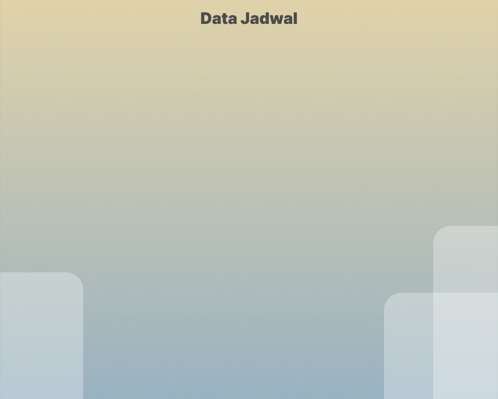
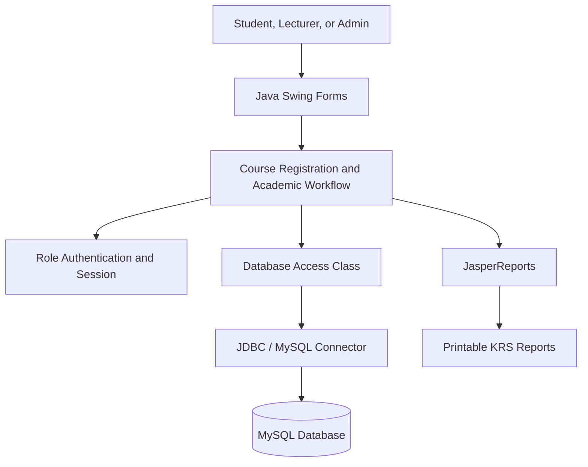

# KRS Academic Management System

The KRS Academic Management System is a Java desktop application developed as an **Object-Oriented Programming (PBO), Semester 4** course project. It supports a course-registration workflow involving students, academic advisors, and administrators.

> **Project type:** Desktop application  
> **Project context:** Academic project — Semester 4  

## 1. Application preview

The repository includes UI design and application preview images.

### Home page


### Login page


### KRS detail


### Schedule management


## 2. Main features

- Role-based login for **students, lecturers, and administrators**
- Management of study programs, students, lecturers, courses, classes, rooms, and schedules
- Student course-registration submission and course selection
- Duplicate-course and timetable-conflict checks
- Academic-advisor (Dosen PA) review and approval
- Study-program coordinator (Kaprodi) finalization
- KRS archiving and report printing with JasperReports

## 3. Technology stack

- Java (Maven compiler release 8; JDK 17 is recommended for the current build environment)
- Java Swing
- MySQL and JDBC
- MySQL Connector/J 8.3.0
- JasperReports 7.0.3
- NetBeans AbsoluteLayout
- NetBeans GUI Builder

## 4. Architecture overview

The application is structured as a Java Swing desktop program. UI forms support role-specific workflows and call the database access class for authentication and data operations. The database layer uses JDBC and prepared statements for parameterized queries. JasperReports is used for report generation.



## 5. Demo and local setup

A **browser-based simulation** of the academic workflows is available in [`demo/index.html`](demo/index.html). It demonstrates student course selection, duplicate and timetable-conflict checks, Dosen PA approval, and study-program finalization using fictional sample data. It is a web adaptation for portfolio viewing, not the original Java Swing executable, and it does not connect to the campus database.

To publish the demo, enable GitHub Pages at **Settings → Pages → Build and deployment → Source: GitHub Actions**, then run **Deploy browser demo** from the Actions tab. After deployment, the public URL will be: https://samuelphe.github.io/krs_pbo2_semester4/.

The original Java application can still be run locally:

1. Install JDK 17 and Maven.
2. Prepare a MySQL or MariaDB database named `krs_db`. The repository does not include a complete database dump or schema.
3. Restore the schema from a trusted local coursework backup.
4. Set the database environment variables:
   - `DB_URL` (optional; default: `jdbc:mysql://127.0.0.1:3306/krs_db?serverTimezone=UTC`)
   - `DB_USER`
   - `DB_PASSWORD`
5. Build the application:

   ```bash
   mvn clean compile
   ```

6. Run the application:

   ```bash
   mvn exec:java
   ```

The provided migration script `database/password_hash_migration.sql` should only be applied to a backed-up database copy after reviewing its effect. No demo account or real student data is provided.

## 6. Project structure

- `src/main/java/PBO_Project_2/` — Swing forms, academic workflows, session, password, and database classes
- `src/main/resources/desain/` — UI design and preview images
- `pom.xml` — Maven compiler and dependency configuration
- `database/` — database migration note

## 7. Copyright and license

This is a collaborative academic project developed by the following team members:

- Davent Gravando
- Marsha Marthalina
- Samuel
- Wendy Lo

This attribution recognizes the project team and does not claim that the entire project or every contribution is solely owned by Samuel Phe. Ownership and rights in jointly created materials and individual contributions remain with the respective authors or rightsholders, subject to any applicable team, course, institutional, or other agreements.

No open-source license is granted by this repository for project materials created by the team. Permission to copy, modify, redistribute, sublicense, or reuse team-created materials should be obtained from the relevant rightsholders. Java, MySQL Connector/J, JasperReports, NetBeans components, and other third-party libraries remain subject to their own licenses and notices. See the [LICENSE](LICENSE) file.
---

This is an academic portfolio project, not a production-ready university information system. Validate the database schema and test the application using a disposable database copy before any demonstration.


## Project team and credits

This academic project was developed collaboratively by the following team members:

- Davent Gravando
- Marsha Marthalina
- Samuel
- Wendy Lo

The names above acknowledge the project team as a whole. Individual module-level responsibilities are not assigned here because a verified task-allocation record was not provided. This credit does not imply that every member authored every file or that each contribution was identical.


## Copyright and licensing

This is a collaborative academic project credited to the team members listed above. This notice does not assign or transfer copyright and does not make a legal determination about ownership of jointly created work. Rights in individual contributions remain with their respective authors or rightsholders, subject to any applicable team, course, institutional, or other agreements. No open-source license is granted by this repository. Permission to reuse team-created materials should be obtained from the relevant rightsholders. Third-party libraries and assets remain subject to their own licenses and notices. See [LICENSE](LICENSE).
